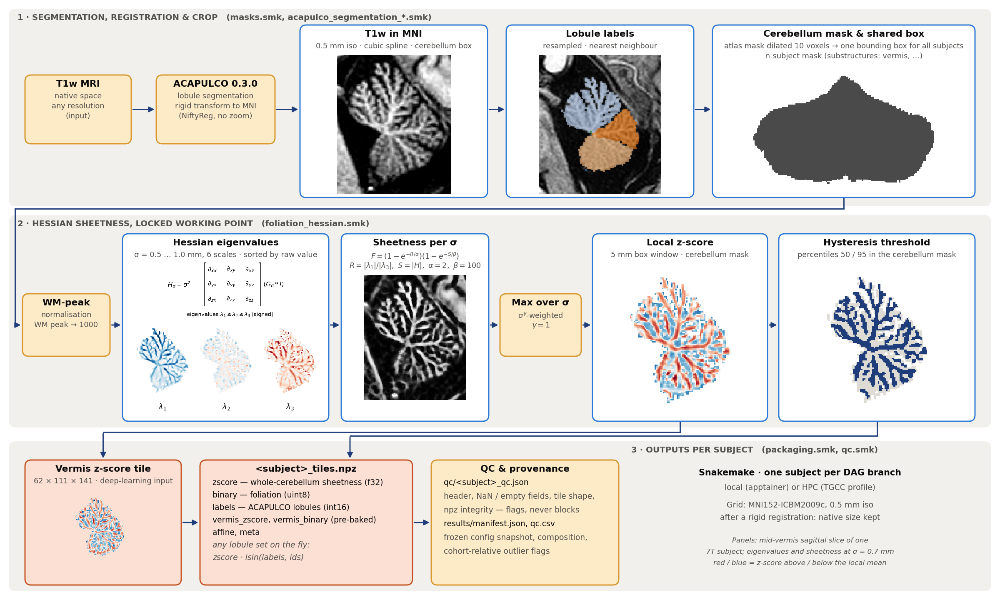

# Cerebellar tiles pipeline

Snakemake pipeline that extracts the cerebellar white-matter foliation (arbor vitae) from a
T1-weighted MRI as a Hessian-based *sheetness* field, and packages per-subject volumes for
downstream deep learning. It runs one subject per DAG branch and scales to large cohorts on an
HPC (TGCC).



## What it produces

For each subject, on a shared MNI 0.5 mm cerebellum grid:
- a continuous **local z-score sheetness** field (the deep-learning input),
- a **hysteresis foliation binary** (the extracted arbor vitae),
- per-substructure tiles (e.g. vermis); any other lobule set can be cut on the fly,
- a single `.npz` bundle for a dataloader,
- per-subject **QC**, and a dataset-level **manifest**.

## Outputs

Per subject (`results/<subject>/`):

| Output | Content |
|---|---|
| `<sub>_tiles.npz` | whole-cerebellum `zscore` (f32), `binary` (uint8), Acapulco `labels` (int16), `affine`, `meta`, and the pre-baked substructure tiles (`vermis_zscore`, `vermis_binary`) |
| `sheetness/<sub>_local_z_score_sheetness_filter5mm.nii.gz` | continuous sheetness field |
| `sheetness/<sub>_foliation_binary.nii.gz` | whole-cerebellum foliation binary |
| `<sub>_<substructure>_foliation_binary_cropped.nii.gz` | per-substructure binary tile |
| `<sub>_<substructure>_zscore_cropped.nii.gz` | per-substructure sheetness tile (pre-baked substructures only) |
| `bbox_cerebellum/<sub>_seg_acapulco_cropped.nii.gz` | Acapulco lobule labels |
| `bbox_cerebellum/<sub>_t1w_cropped.nii.gz`, `masks/…`, transforms | cropped T1w, masks, MNI transforms |
| `qc/<sub>_qc.json` | per-subject validity checks |

Dataset level (`results/`): `manifest.json` (provenance, frozen working point, composition, QC
summary, caveats), `qc.csv`, `config_snapshot.json`.

The NIfTI files hold the authoritative geometry; the `.npz` `affine` is read from the AIMS header.

Any substructure in a dataloader:
```python
d = np.load("<sub>_tiles.npz")
vermis = d["zscore"] * np.isin(d["labels"], [60, 70, 80, 90, 100])  # any lobule set (Acapulco ids)
```

## Requirements

- **Snakemake** ≥ 9.14.0, with the `cluster-generic` executor plugin for the TGCC profile.
- **Acapulco** 0.3.0 container (cerebellum segmentation), CPU `.sif` —
  [GitLab](https://gitlab.com/shuohan/acapulco).
- **`soma` / `aims`** (NIfTI I/O) from [Morphologist](https://brainvisa.info/web/morphologist.html):
  provided by the pixi env (`morphologist ≥ 6.0.5`) locally, or `module load morphologist/5.2` on TGCC.

The local env is reproducible with **pixi** (`pixi.toml`, `pixi.lock`): `pixi install`; rules then
run under `pixi run …` (`config.yaml → environments.pixi_env`).

## Repository structure

```
.
├── cerebellar_tiles.smk        # master Snakefile: config, subjects, rule all, includes, cleanup
├── config.yaml                 # parameters and placeholder paths: fill in locally
├── subjects.txt                # one subject id per line (path set in config)
├── rules/
│   ├── acapulco_segmentation_tgcc.smk    # Acapulco via pcocc-rs (TGCC)
│   ├── acapulco_segmentation_local.smk   # Acapulco via apptainer (local); one is included per platform
│   ├── masks.smk               # transforms, MNI resampling, binarisation, dilation, boxes, fusion
│   ├── foliation_hessian.smk   # the locked sheetness extraction chain
│   ├── packaging.smk           # substructure z-score tiles and the per-subject .npz
│   └── qc.smk                  # per-subject QC and dataset manifest
├── scripts/                    # one script per rule (soma.aims / numpy)
├── containers/                 # Acapulco .sif files (not tracked)
├── profiles/tgcc/              # TGCC cluster-generic submit and status scripts
├── profiles/tgcc-flux/         # TGCC profile running inside a flux allocation
├── hpc_running_example.slurm   # example ccc_msub job wrapping the snakemake call
└── pixi.toml, pixi.lock        # local env
```

`logs/`, `inputs/` and `results/` are created at run time.

## Configuration

`config.yaml` groups:
- **Inputs**: `raw_data`, `data_structure`, `suffix_nifti`, `subject_list`. **Outputs**:
  `output_folder`, `logs`, `benchmark`.
- **Frozen working point** — the locked pipeline; change only on purpose:

  | Parameter | Value | Step |
  |---|---|---|
  | `target_wm_value` | 1000 | white-matter peak normalisation |
  | `sigmas` | 0.5, 0.6, 0.7, 0.8, 0.9, 1.0 mm | Hessian scales |
  | `alpha`, `beta` | 2, 100 | sheetness filter (`beta` is the per-dataset tuning lever) |
  | `gamma_power` | 1 | σ^γ weighting before the max over scales |
  | `window_size` | 5 mm | local z-score |
  | `min_percentile`, `max_percentile` | 50, 95 | hysteresis, within the cerebellum mask |

- **Masks**: `substructures_masks` (atlas ROIs), `prebaked_tiles` (substructures stored as tiles in
  the `.npz`), dilations (cerebellum atlas 10 voxels, substructures 5 voxels).
- **Cleanup**: `cleanup_intermediates` removes the per-σ and aggregation volumes, orphan `.minf`
  sidecars and empty folders on success.

## How to run

1. Fill in `config.yaml` and `subjects.txt`.
2. Put the Acapulco container in `containers/` and install the local env (`pixi install`).
3. Launch.

**Locally** (apptainer for Acapulco):
```sh
snakemake -s cerebellar_tiles.smk --configfile config.yaml \
  -j <max_jobs> --use-apptainer --apptainer-args "--bind <data_paths>"
```

**On TGCC** with the cluster profile:
```sh
snakemake -s cerebellar_tiles.smk --configfile config.yaml \
  -j <max_jobs> --profile profiles/tgcc
```
`hpc_running_example.slurm` is a full `ccc_msub` wrapper. Keep `-j` below the queue's `MaxSub`,
and keep the status polling slow (TGCC asks for at most 1–2 scheduler queries per minute).

The Acapulco rule depends on the platform's container policy (`pcocc-rs` on TGCC, apptainer
locally); `config.yaml → execution` selects it.

Re-running a completed workflow is a no-op that still runs the cleanup.

## Pipeline steps

One subject per branch. After registration, everything lives on the MNI152-ICBM2009c 0.5 mm grid.

**Segmentation** (`acapulco_segmentation_*`)
- `acapulco_segmentation` — Acapulco: native and MNI lobule segmentation, and the rigid
  native → MNI transform (NiftyReg, no scaling: native size is kept).

**Masks and registration to MNI** (`masks.smk`)
- `copy_mask_and_transform` — copy Acapulco's transforms and segmentations out of its working folder.
- `resampling_mni_registration_t1w` / `_acapulco_mask` — resample the T1w (cubic spline) and the
  segmentation (nearest neighbour) to MNI 0.5 mm.
- `binarisation_acapulco_mask` — whole-cerebellum mask from the MNI segmentation.
- `dilatation_mask_substructure` — dilate each atlas substructure ROI (vermis, cerebellum, …).
- `compute_bbox_cerebellum` — bounding box of the dilated cerebellum atlas mask, shared by all
  subjects, so every tile has the same shape.
- `apply_cerebellum_bbox_*` — crop the mask, labels, T1w and substructure ROIs to that box.
- `fusion_acapulco_substructures_mask` — intersect each atlas ROI with the subject's whole-cerebellum
  mask, which trims the dilation to tissue without relying on lobule labels.
- `compute_bbox_substructure` — per-substructure bounding box, shared across subjects.

**Hessian foliation extraction** — the locked chain (`foliation_hessian.smk`)
- `wm_peak_normalisation` — rescale the T1w so the white-matter histogram peak reaches a fixed value.
- `compute_eigvals` — Hessian eigenvalues per scale σ, sorted by raw value (signs kept).
- `compute_sheetness` — `F = (1 − e^(−R/α))·(1 − e^(−S/β))` per σ, with R = |λ₁|/|λ₃| and
  S the Frobenius norm of the Hessian.
- `gamma_normalisation` — scale each σ response by σ^γ.
- `aggregation_argmax` — max (and argmax) over scales.
- `z_score_normalisation` — local box-filter z-score within the cerebellum mask.
- `hysteresis_threshold` — hysteresis binarisation, percentiles taken within the cerebellum mask.
- `apply_mask_substructure` / `apply_bbox_substructure` — mask and crop the binary per substructure.

**Packaging** (`packaging.smk`)
- `apply_mask_substructure_zscore` / `apply_bbox_substructure_zscore` — the same for the z-score
  field, giving the pre-baked sheetness tiles.
- `package_npz` — bundle z-score, binary, labels, pre-baked tiles, affine and metadata into
  `<subject>_tiles.npz`.

**QC and manifest** (`qc.smk`)
- `freeze_config` — snapshot of the full config in the results folder.
- `qc_subject` — header sform/qform consistency, empty or NaN fields, tile shape, `.npz` integrity
  → `<subject>_qc.json`. It flags and never blocks.
- `gather_manifest` — all QC, cohort-relative outlier flags and the frozen config →
  `manifest.json` and `qc.csv`.

Topology metrics (Betti numbers) are computed in a separate analysis pass, so the production
environment needs no extra dependency.
